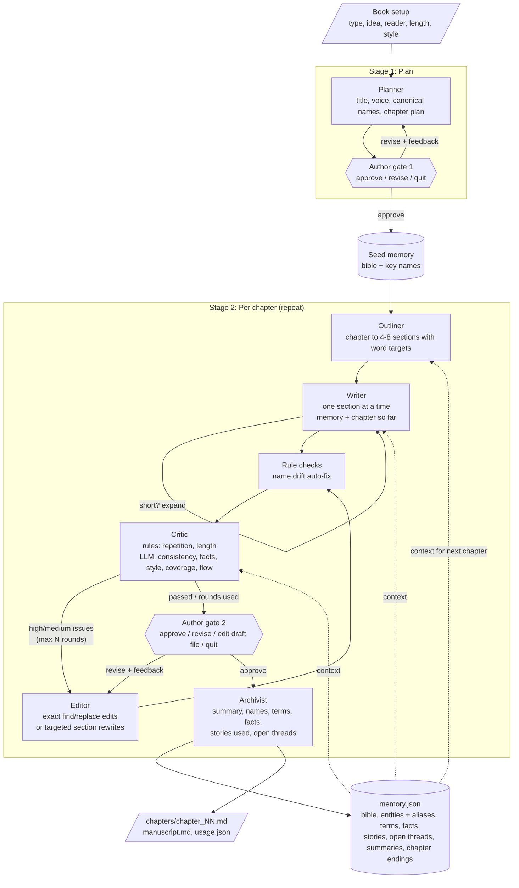

# Architecture: Book Writing Agent OS (Part 1)

## Files on disk (`book_data/<book>/`)

| File | Written when | Purpose |
|---|---|---|
| `setup.json` | start | the book setup |
| `plan_draft.json` / `plan_approved.json` | gate 1 | plan; approved plan is reused on resume |
| `drafts/chapter_NN.json` | after every section | resumable chapter state (outline + sections) |
| `drafts/chapter_NN.md` | before gate 2 | draft the author can read and edit directly |
| `review_chNN.json` | before gate 2 | critic findings, stats, auto-fixes |
| `chapters/chapter_NN.md` | after gate 2 | final approved chapter |
| `memory.json` | after gate 1 and each gate 2 | the book's long-term memory |
| `manuscript.md`, `usage.json` | end of run | compiled book; tokens per agent and optional cost |
